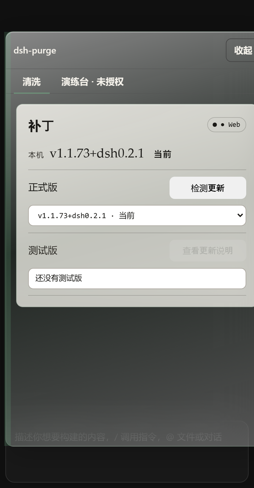
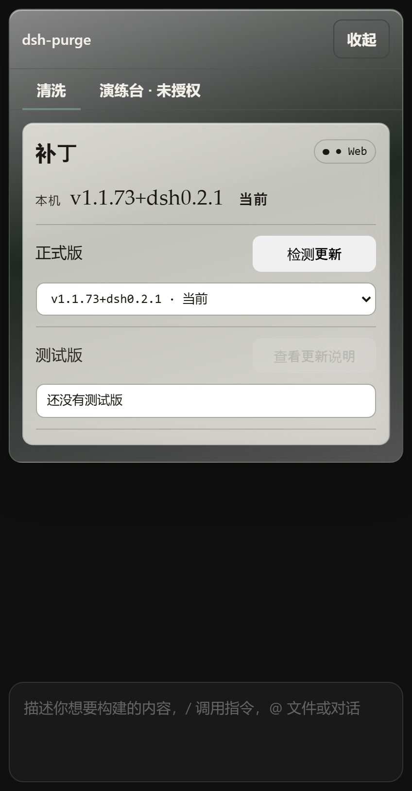

# dsh-mobile-fixes

[DeepSeek Harness](https://github.com/deepseek-ai) 的窄屏（手机）CSS 覆盖层。

它的全部工作是**往 `document.head` 注入一张 `<style>`**：不接管 DOM、不注册插槽、不装 `MutationObserver`、不绑事件。上游插件一个字节都不改，类名不变就继续生效；停用它，页面就回到上游原样。

> 曾经有过教训：另一个插件用 500ms 一次的 `document.body` 扫描做"清理"，把宿主的设置弹层当成残留删了，且因为删除发生在 React 之外，控制台一句报错都没有。样式表删不掉任何节点，所以这里是补丁形态的上限。

## ⚠️ 覆盖范围（先读这段）

**本插件只包含两个补丁，且只在下面这两个插件的特定版本上实测过：**

| 目标插件 | 修的问题 | 实测版本 |
|---|---|---|
| `dsh-expert` · T专家弹窗（`.t-team-pop`） | 4 列卡片在窄屏被压成 ~79px，名字截图、标签行被切 | 2026-11 的在用版本 |
| `dsh-purge` · 悬浮净化面板（`.dshp-dock` / `.dshp-launch`） | 面板右溢、按钮被切；悬浮入口压住输入框发送键 | `1.1.73+dsh0.2.1` |

**除此之外没有任何插件被验证过。** 它不是通用"手机适配框架"，也没有对其它 DSH 插件做任何承诺——没实测过的东西不写进来。你想加第三个补丁，请先自己量到问题（见下面的"怎么加一个补丁"）。

所有规则都锁在 `@media (max-width: 640px)` 里，桌面宽度不受影响。

## 安装

DSH 支持直接从 GitHub 装插件：

```bash
# 在 profile 目录下（例如 ~/.dsh/profiles/web）
dsh plugin add github:ymf2317-tech/dsh-mobile-fixes
```

或者手工接线（和本机 vendor 用法一致）：把仓库放到 profile 的 `vendor/` 下，`package.json` 里加依赖与白名单，然后重新 `pnpm install`：

```jsonc
{
  "dependencies": { "dsh-mobile-fixes": "file:vendor/dsh-mobile-fixes" },
  "dsh": { "profile": { "bundles": [ /* … */ "dsh-mobile-fixes" ] } }
}
```

注意是 `dsh.profile.bundles`，**不是** `dsh.bundle.plugins`。

**生效方式：刷新页面。** 客户端模块清单会带上 `client.js`，不用重启宿主。

## 补丁一：dsh-expert · T专家弹窗

**现象**（390px 手机）：弹窗四列卡片每列约 79px，名字截成「端侧 Rikk…」，分类标签行被切。

**成因**：上游把网格写死成 `repeat(4, minmax(0,1fr))`（作者注释写明"用户明确要求固定 4 个"），没有任何按宽度的回退。弹窗本身 `width: var(--t-team-pop-w, 720px)` + `max-width: calc(100vw - 16px)`，390px 屏上弹窗 374px，扣掉内边距与子元素外边距后内容 354px，四列各 `(354 - 3×12)/4 ≈ 79px`。

**覆盖内容**：

1. `experts` / `skills` 两个 tab 的列表 → `repeat(2, minmax(0,1fr))`，gap `8px 10px`（每列 ≈172px）
2. 名字与副标题：`nowrap` + 省略号 → 允许换行，夹 2 行
3. 头像 44px → 36px，`.t-team-pop-head` 高度 auto
4. 搜索框 `font-size: 16px`、高 36px —— iOS Safari 聚焦 `font-size < 16px` 的输入框会自动放大整页，而"搜索专家"正是这个弹窗的主入口
5. 分类标签条隐藏滚动条（上游已有 `overflow-x: auto` 与两侧箭头）
6. `max-height` → `calc(100dvh - 16px)`（手机 `100vh` 含地址栏）

## 补丁二：dsh-purge · 悬浮净化面板

**现象**（424px 级手机）：面板右边缘出屏，「收起」「检测更新」「查看更新说明」右半被切；右下角 `dsh-purge` 胶囊压在输入框发送键上。

| 修复前（424px，页面缩放 1.08） | 修复后 |
|---|---|
|  |  |

**成因**（两处，都在 dsh-purge 自己身上）：

1. `PurgeDock` 把位置写进**内联 style**：`left: geom.x+"px" / width: geom.w+"px" / height: geom.h+"px"`；而 `clampDockGeom()` 是
   ```js
   const w = Math.min(Math.max(380, Number(g && g.w) || 620), Math.max(380, vw - 16));
   ```
   —— `Math.max(380, vw - 16)` 在窄屏下把**上限**也抬到 380，`min-width: 380px` 同理。手机壳再把整页 `zoom` 放大（实测 1.08），内联的 408px 变成 441px，右边界落到 449px，而视口只有 424px；`.dshp-dock` 又是 `overflow: visible`，溢出部分直接画到屏幕外。
2. `.dshp-launch` 钉在 `right: 16px; bottom: 16px`，桌面上没问题，手机上矩形与发送键直接相交。

**覆盖内容**：

1. `html body .dshp-dock`：`left/right/top: 8px` + `width/height: auto` + `min-width: 0` + `max-width: none` + `max-height: calc(100dvh - 96px)`。
   这四行用了 `!important`（**全文件唯一的 `!important`**）：内联样式无法用特异性压过，只能这样。代价是窄屏下不能拖拽改面板尺寸——触屏本来也抓不住那 10px 的拖拽边条。
2. 内部：`root` padding 16→12、gap 18→14；`panel` padding 18→14/12；`edition-name` 允许换行
3. `.dshp-dock-resize{,-l,-r,-b}` → `display: none`（触屏抓不住，只在边缘吃点击）
4. `.dshp-launch` → `right: 8px; bottom: calc(140px + env(safe-area-inset-bottom))`，高 32、透明 0.72

**实测**（Playwright + 本机 Chrome，按真机宽度复刻面板）：

| 场景 | 修复前右边缘 | 修复后右边缘 |
|---|---|---|
| 360px · 无缩放 | 388（溢出 28px） | 352（内收 8px） |
| 390px · 缩放 1.08 | 419（溢出 29px） | 381（内收 9px） |
| 424px · 缩放 1.08 | 449（溢出 25px） | 415（内收 9px） |

面板高度从硬编码的 640px 变成内容自适应（≈433px），内部 `scrollWidth == clientWidth`。

> 根治点在 dsh-purge 上游：把内联尺寸换成 CSS 变量、把 `Math.max(380, vw - 16)` 改成 `Math.min(380, vw - 16)`。这个补丁只是让用户不必等。

## 设计纪律

1. **一张样式表，零逻辑。** 不建节点、不监听、不观察。
2. **全部规则包在 `@media (max-width: 640px)`**，桌面必须一模一样。
3. **选择器一律 `html body` 前缀。** 上游的 `<style>` 往往比我们晚注入，同特异性下后来者胜，整块会静默失效——这坑踩过（`.t-team-pop` 的宽度覆盖生效、列数覆盖没生效，同一张表同一时刻，说明不是被忽略而是被后注入的规则压掉）。
4. **尽量不用 `!important`。** 只有当目标属性被写成内联 style 时才用，且只在那一处、只锁盒模型。

## 怎么加一个补丁

先量，再写：

1. 在 `client.js` 的 `@media` 块里加一段注释，写清**哪个插件、哪个类名、什么现象、成因是什么**——没有成因的覆盖三个月后没人看得懂。
2. 用真机宽度（360 / 390 / 424px）复现，量 `getBoundingClientRect()` 与 `scrollWidth`，不要靠肉眼。
3. 桌面宽度回归一次，确认没动。
4. 把目标插件的类名写进 README 的覆盖范围表，并注明实测版本。

## 回滚

删掉那张 `<style>` 就等于没装过：

- 停用插件（从 `dsh.profile.bundles` 移出）→ 刷新页面；
- 或临时在控制台 `document.getElementById('dsh-mobile-fixes')?.remove()`。

## 许可

MIT。
